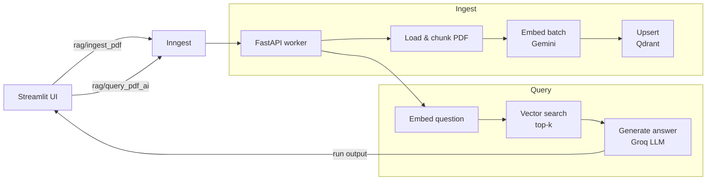

# RAG Production Agent

Ask questions about your PDFs and get answers grounded in their content.

Upload a document, and it is chunked, embedded with **Gemini** and stored in **Qdrant**. Ask a question, and the most relevant chunks are retrieved and passed to an LLM served by **Groq**, which answers using only that context. Every step runs as a durable **Inngest** workflow: it is retried, checkpointed and observable.

---

## Architecture



| Layer | Technology |
|---|---|
| Frontend | Streamlit |
| Orchestration | Inngest (durable steps, retries, run history) |
| API | FastAPI + Uvicorn |
| Parsing & chunking | LlamaIndex `PDFReader` + `SentenceSplitter` (1000 tokens, 200 overlap) |
| Embeddings | Gemini `gemini-embedding-001` (3072-dim) |
| Vector store | Qdrant (cosine similarity) |
| LLM | Groq: `openai/gpt-oss-120b` |

---

## Quickstart

### Prerequisites

- Python 3.13 and [uv](https://docs.astral.sh/uv/)
- Docker (or Colima on macOS)
- Node.js (for the Inngest dev server)
- API keys: [Gemini](https://aistudio.google.com/apikey) and [Groq](https://console.groq.com/keys)

### 1. Install

```bash
uv sync
```

### 2. Configure

Create a `.env` file in the project root:

```env
GEMINI_API_KEY=your-gemini-key
GROQ_API_KEY=your-groq-key

# Optional: embedding rate limits (defaults are tuned for the free tier)
EMBED_TPM_LIMIT=25000
EMBED_RPM_LIMIT=80
EMBED_MAX_RETRIES=6
```

### 3. Run

Start each service in its own terminal:

```bash
# Qdrant (first run)
docker run -d --name qdrant -p 6333:6333 -v "./qdrant_storage:/qdrant/storage" qdrant/qdrant
# ...on later runs: docker start qdrant
```

```bash
# FastAPI worker
uv run uvicorn main:app
```

```bash
# Inngest dev server
npx inngest-cli@latest dev -u http://127.0.0.1:8000/api/inngest --no-discovery
```

```bash
# Streamlit UI
uv run streamlit run streamlit_app.py
```

| Service | URL |
|---|---|
| App | http://localhost:8501 |
| Inngest dashboard | http://localhost:8288 |
| Qdrant dashboard | http://localhost:6333/dashboard |

---

## How it works

**Ingest (`rag/ingest_pdf`)**
1. The PDF is parsed and split into overlapping, sentence-aware chunks.
2. Chunks are grouped into batches that fit inside one minute of embedding quota.
3. Each batch is its own Inngest step: it is embedded, then upserted with deterministic UUIDs (`source_id:index`). Re-uploading the same file overwrites its points instead of duplicating them.

**Query (`rag/query_pdf_ai`)**
1. The question is embedded with the same model.
2. The top-k nearest chunks are retrieved from Qdrant.
3. The LLM answers using only the retrieved context, and the answer is returned with its sources.

---

## Production details

- **Embedding rate limits.** A sliding-window limiter keeps embedding requests within the Gemini tokens- and requests-per-minute quota. Quota errors (429) are retried with exponential backoff and jitter. Large documents ingest slowly but reliably instead of failing.
- **Checkpointed ingestion.** Finished batches are saved by Inngest. If a step fails, only that batch is retried, never the whole document.
- **Idempotent uploads.** Each upload is fingerprinted by its contents (SHA-256). The UI sends it only once, and the event ID makes Inngest drop duplicate sends.
- **Grounded answers.** The system prompt limits the model to the retrieved context, which reduces hallucination.

---

## Project structure

```
├── main.py            # FastAPI app + Inngest functions (ingest, query)
├── data_loader.py     # PDF loading, chunking, rate-limited embeddings
├── vector_db.py       # Qdrant wrapper (collection setup, upsert, search)
├── custom_types.py    # Pydantic models for step inputs/outputs
├── streamlit_app.py   # Upload + Q&A frontend
└── qdrant_storage/    # Persistent vector data (Docker volume)
```

---

## Testing without the UI

You can trigger events directly from the Inngest dashboard (**Send event**):

```json
{ "name": "rag/ingest_pdf", "data": { "pdf_path": "/absolute/path/to/file.pdf" } }
```

```json
{ "name": "rag/query_pdf_ai", "data": { "question": "What is this document about?", "top_k": 5 } }
```

---

## Notes

- **Free-tier throughput:** about 25 chunks per minute. A 500-chunk PDF takes about 20 minutes. Wait for ingestion to finish in the Inngest dashboard before asking about a new document.
- **Changing the embedding model** changes the vector size. Update `dim` in `vector_db.py` and recreate the `docs` collection.

## Roadmap

- [ ] Hybrid search (BM25 + dense) and reranking
- [ ] Per-document filtering at query time
- [ ] Streaming answers with inline citations
- [ ] Evaluation suite (retrieval recall, answer faithfulness)
