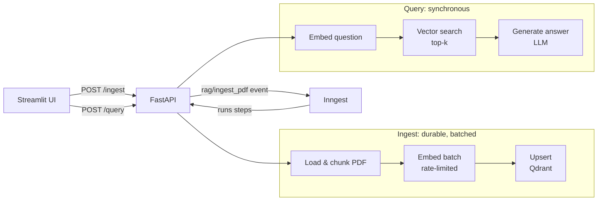

# RAG Production Agent

Ask questions about your PDFs and get answers grounded in their content.

Upload a document, and it is chunked, embedded with **Gemini** and stored in **Qdrant**. Ask a question, and the most relevant chunks are retrieved and passed to an LLM served by **Groq**, which answers using only that context. Long-running ingestion runs as a durable **Inngest** workflow: it is retried, checkpointed and observable. Providers are swappable: **Azure OpenAI** works for both embeddings and generation through a config setting.

---

## Architecture



The UI only talks to the API. Ingestion can take minutes on the free tier, so it is handed to Inngest. Queries take seconds, so they are answered directly. Both paths call the same core module, [`pipeline.py`](src/rag_production_agent/pipeline.py).

| Layer | Technology |
|---|---|
| Frontend | Streamlit |
| Orchestration | Inngest (durable steps, retries, run history) |
| API | FastAPI + Uvicorn |
| Parsing & chunking | LlamaIndex `PDFReader` + `SentenceSplitter` (1000 tokens, 200 overlap) |
| Embeddings | Gemini `gemini-embedding-001` (3072-dim), or Azure OpenAI |
| Vector store | Qdrant (cosine similarity) |
| LLM | Groq: `openai/gpt-oss-120b`, or Azure OpenAI |
| Config | `pydantic-settings` (typed, from env / `.env`) |
| Packaging | uv, Docker (multi-stage, non-root), docker-compose |

---

## Quickstart

### Prerequisites

- Python 3.13 and [uv](https://docs.astral.sh/uv/)
- Docker (or Colima on macOS)
- Node.js (for the Inngest dev server)
- API keys: [Gemini](https://aistudio.google.com/apikey) and [Groq](https://console.groq.com/keys)

### 1. Install

```bash
uv sync                 # add --extra azure for the Azure OpenAI providers
cp .env.example .env    # then fill in GEMINI_API_KEY and GROQ_API_KEY
```

All settings live in [`config.py`](src/rag_production_agent/config.py); `.env.example` lists every option.

### 2. Run with Docker (one command)

```bash
docker compose up --build
```

### 2b. …or run each service locally

Start each one in its own terminal:

```bash
docker run -d --name qdrant -p 6333:6333 -v "./qdrant_storage:/qdrant/storage" qdrant/qdrant
```

```bash
uv run uvicorn rag_production_agent.api:app --reload
```

```bash
npx inngest-cli@latest dev -u http://127.0.0.1:8000/api/inngest --no-discovery
```

```bash
uv run streamlit run src/rag_production_agent/ui/app.py
```

| Service | URL |
|---|---|
| App (UI) | http://localhost:8501 |
| API docs | http://localhost:8000/docs |
| Inngest dashboard | http://localhost:8288 |
| Qdrant dashboard | http://localhost:6333/dashboard |

---

## How it works

**Ingest (`rag/ingest_pdf`)**
1. The PDF is parsed and split into overlapping, sentence-aware chunks.
2. Chunks are grouped into batches that fit inside one minute of embedding quota.
3. Each batch is its own Inngest step: it is embedded, then upserted with deterministic UUIDs (`source_id:index`). Re-uploading the same file overwrites its points instead of duplicating them.

**Query (`POST /query`)**
1. The question is embedded with the same model.
2. The top-k nearest chunks are retrieved from Qdrant.
3. The LLM answers using only the retrieved context, and the answer is returned with its sources. If nothing is retrieved, no LLM call is made.

The same query flow is also available as the Inngest function `rag/query_pdf_ai`, if you want the run history.

---

## Production details

- **Embedding rate limits.** A sliding-window limiter keeps embedding requests within the Gemini tokens- and requests-per-minute quota. Quota errors (429) are retried with exponential backoff and jitter. Large documents ingest slowly but reliably instead of failing.
- **Checkpointed ingestion.** Finished batches are saved by Inngest. If a step fails, only that batch is retried, never the whole document.
- **Idempotent uploads.** Each upload is fingerprinted by its contents (SHA-256). The UI sends it only once, and the event ID makes Inngest drop duplicate sends.
- **Swappable providers.** The pipeline depends only on small `Embedder`, `LLM` and `VectorStore` interfaces. Gemini, Groq and Azure OpenAI are adapters picked in config.
- **Safety checks.** The store refuses to start if the collection's vector size doesn't match the embedding model. Upload filenames are sanitised. Health (`/health`) and readiness (`/ready`) endpoints are ready for container orchestrators.
- **Grounded answers.** The system prompt limits the model to the retrieved context, which reduces hallucination.

---

## Project structure

```
src/rag_production_agent/
├── config.py           # Typed settings (env / .env)
├── models.py           # Pydantic models shared across layers
├── prompts.py          # Versioned prompt templates
├── pipeline.py         # The RAG core: chunk, index, retrieve, generate, answer
├── workflows.py        # Inngest functions (thin wrappers around pipeline)
├── api.py              # FastAPI: /health, /ready, /ingest, /query + Inngest endpoint
├── ingestion/
│   └── loader.py       # PDF → pages → sentence-aware chunks
├── providers/
│   ├── base.py         # Embedder / LLM interfaces
│   ├── ratelimit.py    # Token batching, sliding-window limiter, retry
│   ├── gemini.py  groq.py  azure_openai.py  chat.py
├── store/
│   ├── base.py         # VectorStore interface
│   └── qdrant.py
└── ui/app.py           # Streamlit frontend
```

---

## Testing without the UI

Use the interactive API docs at http://localhost:8000/docs, or `curl`:

```bash
curl -X POST localhost:8000/query -H 'Content-Type: application/json' -d '{"question": "What is this document about?"}'
```

Or trigger events directly from the Inngest dashboard (**Send event**):

```json
{ "name": "rag/ingest_pdf", "data": { "pdf_path": "/absolute/path/to/file.pdf" } }
```

```json
{ "name": "rag/query_pdf_ai", "data": { "question": "What is this document about?", "top_k": 5 } }
```

---

## Notes

- **Free-tier throughput:** about 25 chunks per minute. A 500-chunk PDF takes about 20 minutes. Wait for ingestion to finish in the Inngest dashboard before asking about a new document.
- **Changing the embedding model** changes the vector size. Set `EMBED_DIM` and use a new `QDRANT_COLLECTION` (or delete the old one), then re-ingest. The app refuses to start on a mismatch.

## Roadmap

- [ ] Hybrid search (BM25 + dense) and reranking
- [ ] Per-document filtering at query time
- [ ] Streaming answers with inline citations
- [ ] Evaluation suite (retrieval recall, answer faithfulness)
